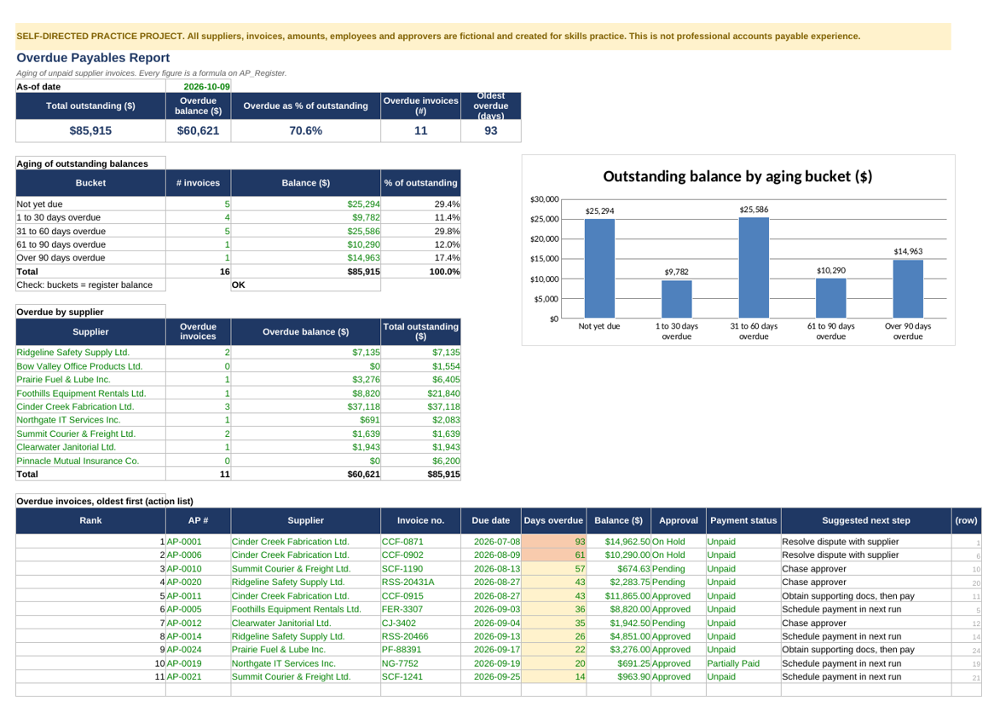

# AP Register and Overdue Payables Report (Practice Project)

> **Self-directed practice project. All suppliers, invoices, amounts, approvers and employees are fictional.** This is not professional accounts payable experience and uses no employer data.

A small Excel accounts payable register that practices the daily steps of invoice processing: logging invoices, checking them, coding expenses, tracking approval and payment, and reporting what is overdue.

## What is inside
| Sheet | Contents |
| --- | --- |
| `AP_Register` | 28 fictional supplier invoices: invoice number, supplier, dates, terms, due date, PO, category, GL code, billable or non-billable, tax billed vs expected, approval and payment status, balance, and six check columns |
| `Overdue_Report` | Aging buckets, overdue by supplier, a ranked action list with a suggested next step, and a chart |
| `Expense_Claims` | 12 fictional employee claims checked for receipt, policy limit, late submission and duplicates |
| `Checks` | What each check catches and the seeded test cases |
| `Process_Note` | The invoice-handling workflow and what I would escalate |
| `Lists` | Suppliers and terms, categories with GL codes, tax codes, policy limits |

## Checks built in
Exact duplicate, probable duplicate (same supplier and total within 14 days), tax variance, missing supporting documents, paid without approval, and date errors. The register was seeded with known problems, and each check matches its expected count (1, 1, 2, 2, 1, 1).

## Result (as of 2026-10-09, fictional data)
$85,915 outstanding, $60,621 overdue (70.6%) across 11 invoices, oldest 93 days. Change the as-of date in `AP_Register!D3` and everything recalculates.

## Limits
GST at 5% is illustrative. No ERP, bank or multi-currency. Policy and approval limits are invented. Not a substitute for real AP experience.
